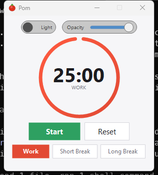
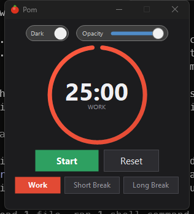

# Pom

A small, always-on-top Pomodoro timer for Windows. One file, no installer, no runtime to install — download `Pom.exe` and double-click it.

<p align="center">
  
  
</p>

## Features

- **Three modes** — Work (25 min), Short Break (5 min), Long Break (15 min), each with its own accent colour
- **Circular progress ring** that drains as the session runs
- **Always on top** so the timer stays visible while you work
- **Light and dark themes**, including a matching Windows title bar
- **Adjustable opacity** — fade the window back to keep it unobtrusive
- **Minimise to tray** — double-click the tray icon to bring it back
- **Completion alerts** — sound, taskbar flash, and toast notification

## Download

Grab the latest `Pom.exe` from the [Releases](https://github.com/cjsharp1/pom/releases) page. It is fully self-contained: no .NET install required.

> Windows SmartScreen may warn about an unrecognised publisher, since the exe is unsigned.
> Click **More info → Run anyway**.

## Usage

| Action | How |
| --- | --- |
| Start / pause | **Start** button, or <kbd>Space</kbd> / <kbd>Enter</kbd> when focused |
| Reset the current mode | **Reset** button |
| Switch mode | **Work**, **Short Break**, or **Long Break** |
| Toggle dark mode | Switch at the top-left |
| Change opacity | Slider at the top-right |
| Hide to tray | Minimise the window |
| Restore from tray | Double-click the tray icon, or right-click → **Show** |

Switching mode resets the timer to that mode's full duration.

## Building from source

Requires the [.NET 10 SDK](https://dotnet.microsoft.com/download).

```powershell
# Standalone single-file exe -> dist\Pom.exe
.\build.ps1

# ...and drop a shortcut on the Desktop
.\build.ps1 -Desktop
```

Or with the SDK directly:

```powershell
dotnet publish src\Pom.csproj -c Release -o publish
```

To run while developing:

```powershell
dotnet run --project src\Pom.csproj
```

## Settings

Settings persist to `%AppData%\Pom\settings.json` and are written whenever you change them:

```json
{
  "PlaySound": true,
  "ShowToast": false,
  "FlashWindow": false,
  "DarkMode": false,
  "Opacity": 1.0
}
```

`ShowToast` and `FlashWindow` have no UI toggle yet — edit the file to enable them.

## Project layout

```
src/                    Application source
  Program.cs            Entry point
  MainForm.cs           Window, layout, timer logic, theming
  TimerDisplay.cs       Circular progress ring and readout
  PomButton.cs          Custom button (primary / secondary / pill)
  SliderControl.cs      Opacity slider
  ToggleSwitch.cs       Dark-mode switch
  Theme.cs              Colour palette and drawing helpers
  IconGenerator.cs      Draws the tomato icon at runtime
  Settings.cs           Load/save settings
build.ps1               One-command standalone build
docs/                   Design notes and screenshots
```

## License

[MIT](LICENSE)
